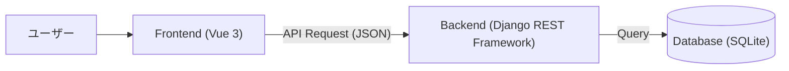
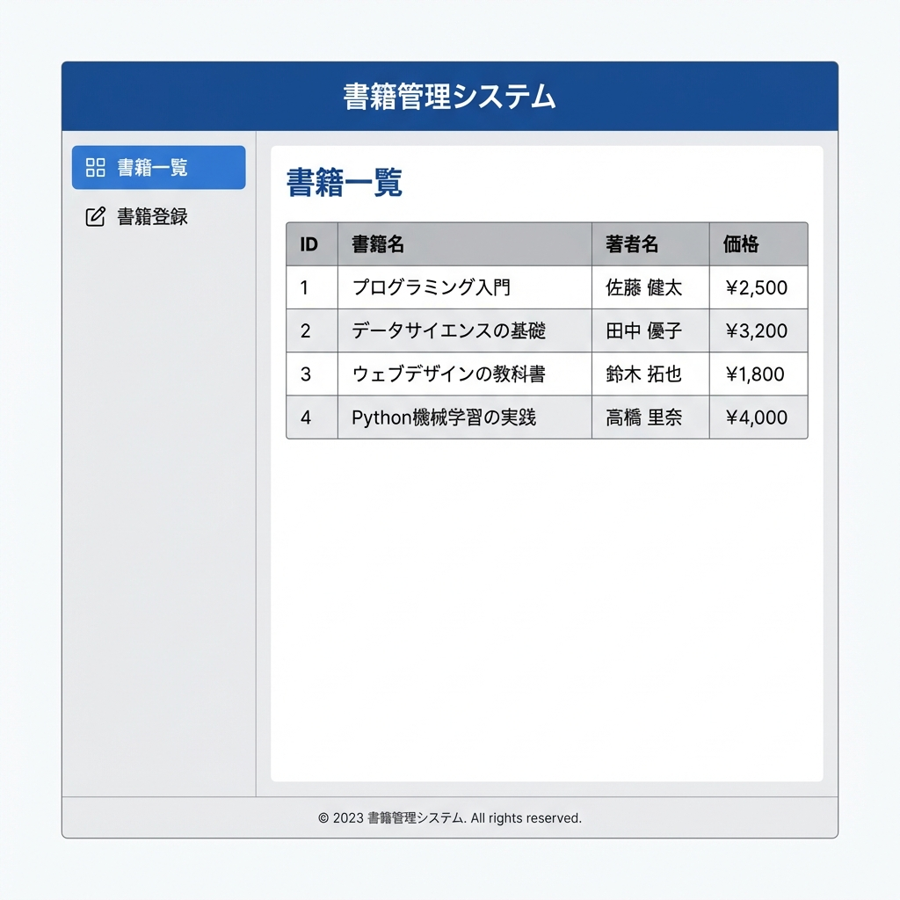
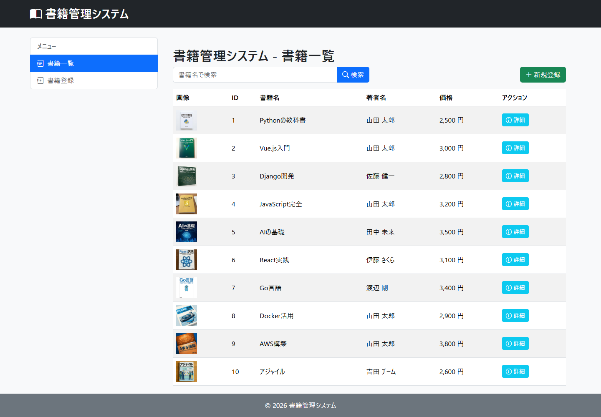
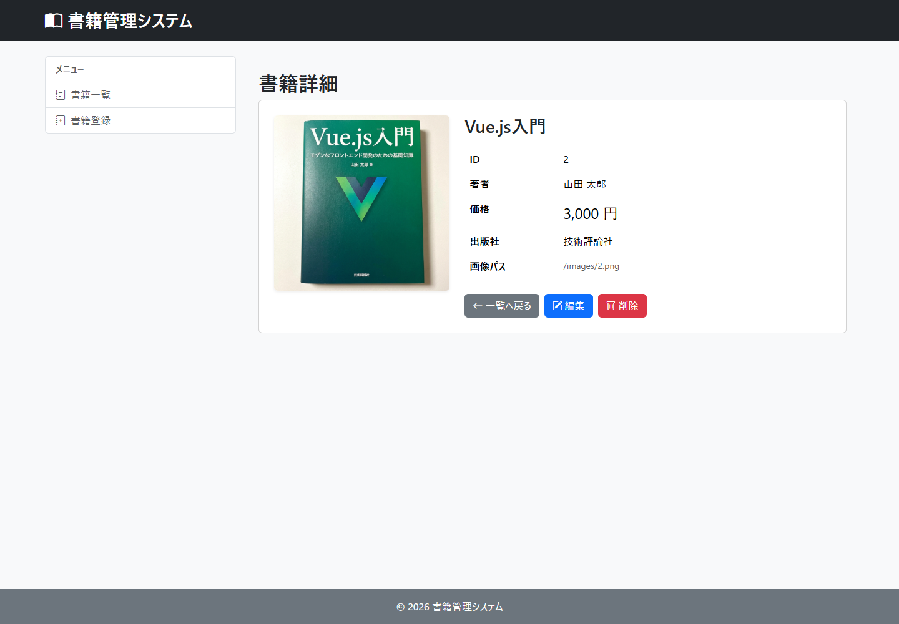
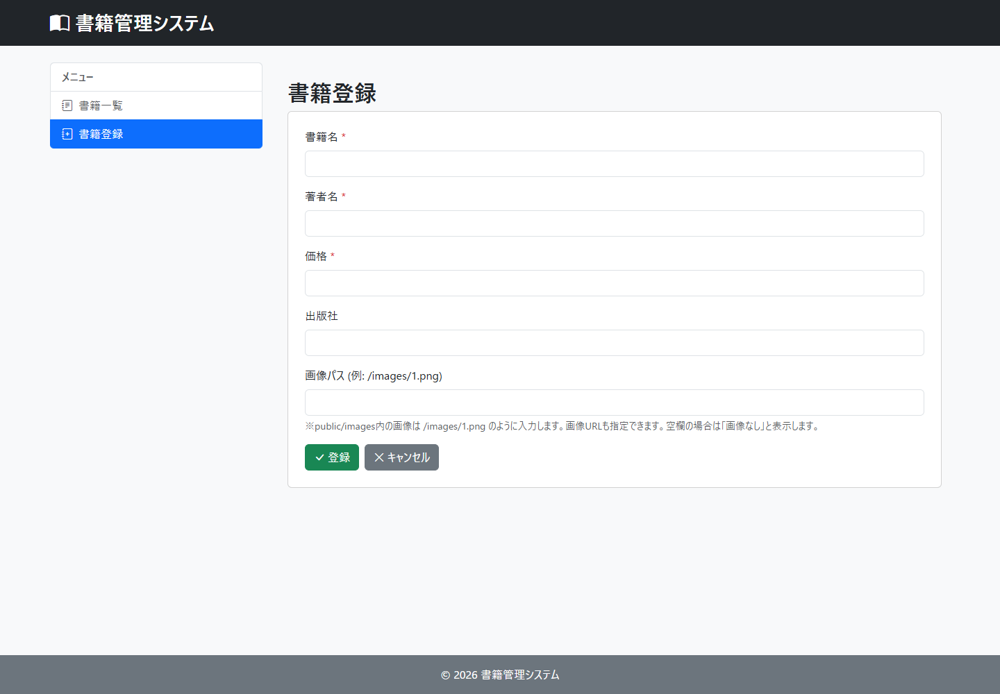
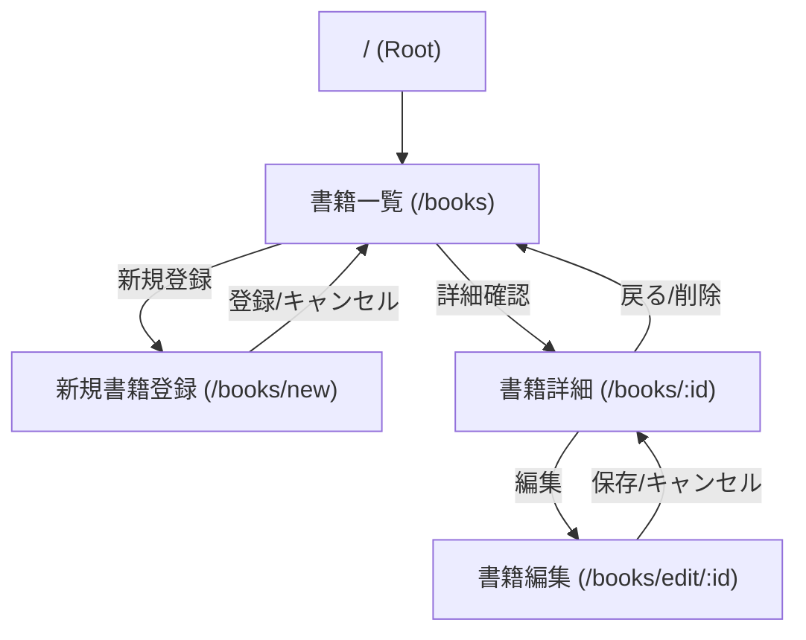
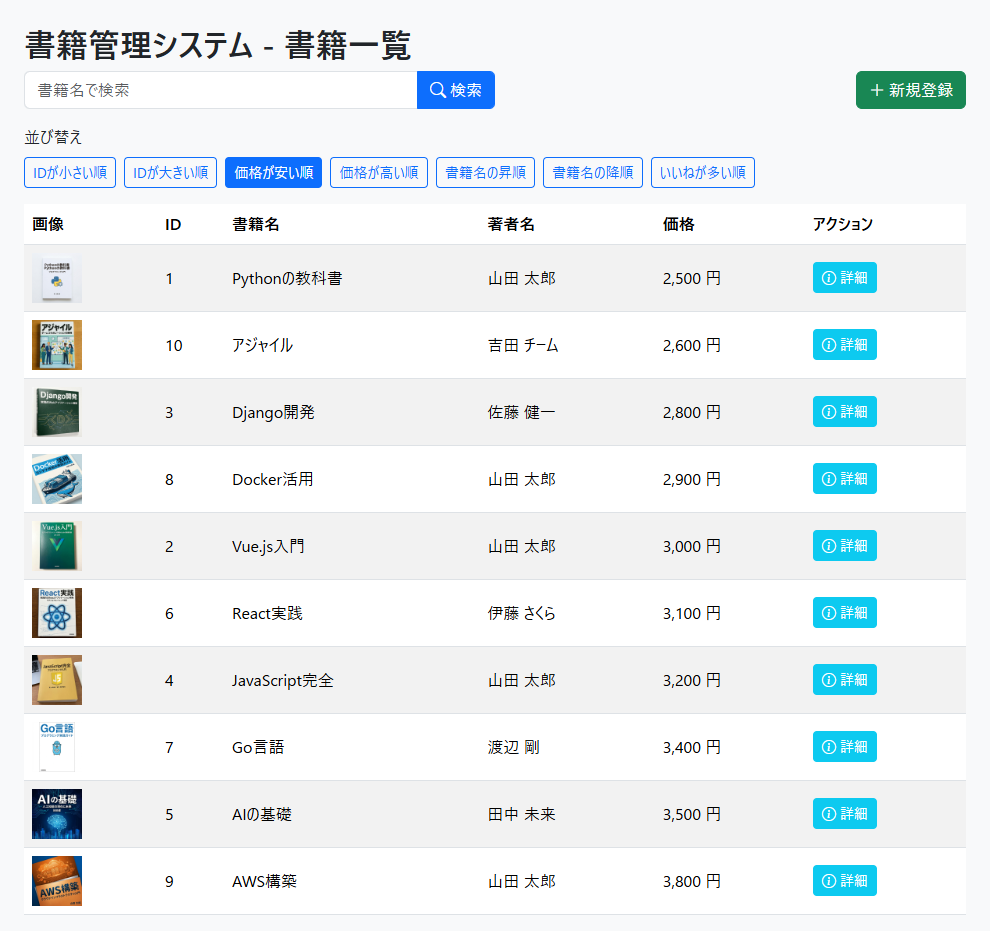
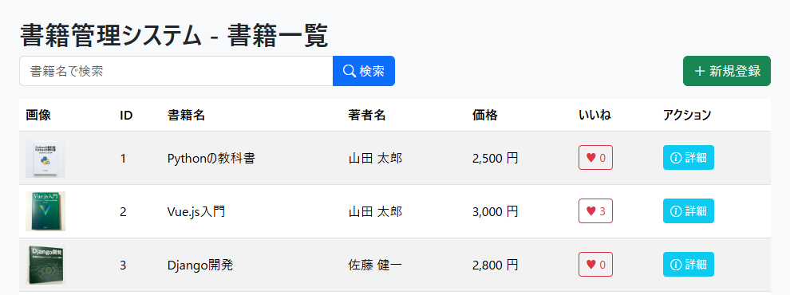
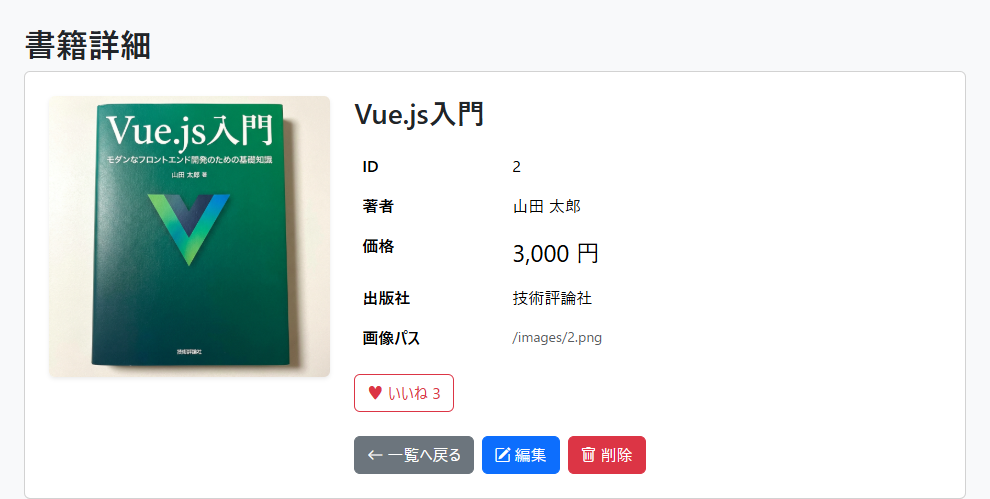
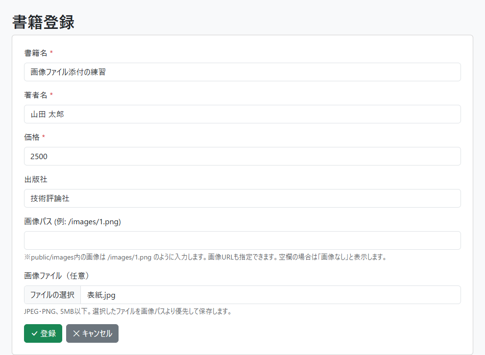

# 書籍管理システム 基本設計書

**バージョン**: v1.1.0  
**作成日**: 2026/01/27  
**更新日**: 2026/11/04

## 1. アーキテクチャ構成
本システムは、FrontendとBackendを分離したSPA（Single Page Application）構成とする。通常の書籍APIはJSON、追加機能の画像アップロードはmultipart形式で送信する。



## 2. データベース設計

### 2.1 テーブル定義: books
書籍情報を格納するテーブル。

| カラム名 | 論理名 | データ型 | 制約 | 説明 |
| --- | --- | --- | --- | --- |
| id | ID | Integer | PK, AutoIncrement | システム内での一意な識別子 |
| title | 書籍名 | CharField | max_length=255, Not Null | |
| author | 著者名 | CharField | max_length=255, Not Null | |
| price | 価格 | Integer | Not Null | 1以上の整数。Serializerで下限1を検証 |
| publisher | 出版社 | CharField | max_length=255, Nullable | |
| image_path | 画像パス | CharField | max_length=255, Nullable | |
| like_count | いいね数 | PositiveIntegerField | Not Null, default=0 | 追加機能専用。基本機能では使わず、列だけ最初から用意 |

モデル名は `Book`、`Meta.db_table` は `books` とする。タイトル・著者名は空文字や空白のみを許可しない。出版社・画像パスは空文字またはnullを許可する。

`like_count` は追加機能（いいね数の表示・加算、いいね数による並び替え）専用の列であり、基本機能の画面表示・登録・編集では使わない。受講者が後から列を追加せずに済むよう、`like_count = models.PositiveIntegerField(default=0)` を最初のモデル定義に含める。初期SQLは全書籍を0で登録し、基本課題のみでは0のまま保持する。Serializerでは `read_only_fields = ['like_count']` とし、通常の登録・更新で上書きしない。API応答にこの項目が含まれていても、基本画面では表示しない。

## 3. API設計 (RESTful API)

| メソッド | エンドポイント | 概要 | リクエストパラメータ | レスポンス |
| --- | --- | --- | --- | --- |
| GET | `http://localhost:8000/api/books/` | 書籍一覧取得 | `keyword` (optional): 書籍名検索 | 書籍オブジェクト配列 |
| POST | `http://localhost:8000/api/books/` | 書籍新規登録 | `title`, `author`, `price`, `publisher`, `image_path` | 作成された書籍オブジェクト |
| GET | `http://localhost:8000/api/books/{id}/` | 書籍詳細取得 | - | 書籍オブジェクト |
| PUT | `http://localhost:8000/api/books/{id}/` | 書籍更新 | `title`, `author`, `price` は必須。編集画面からは任意項目も含む5項目を送信 | 更新後の書籍オブジェクト |
| PATCH | `http://localhost:8000/api/books/{id}/` | 書籍の部分更新 | 変更する項目のみ | 更新後の書籍オブジェクト |
| DELETE | `http://localhost:8000/api/books/{id}/` | 書籍削除 | - | 204 No Content |

- APIのベースURLは `http://localhost:8000/api/`。各URL末尾の `/` を付ける。
- 正常時は取得・更新が200、登録が201、削除が204。入力不備は400、対象なしは404とする。
- 登録時の `publisher` と `image_path` は省略できる。`keyword` を省略または空文字にすると全件取得する。検索結果0件は空配列を返す。
- フロントエンドの編集では、参考用テキストと同じPUTを使用する。PATCHはAPI仕様として対応するが、画面実装では使わない。

### 3.1 オプションAPI（任意実装）

以下はAPIの概要。画面操作・送受信例・実装手順・完成条件は、最後の[第7章「追加機能」](#7-追加機能)にまとめる。

- 並び替え：一覧GETの `ordering` に `id`、`-id`、`price`、`-price`、`title`、`-title`、`-like_count` を指定する。省略・不正な値はID昇順。同値はID昇順とし、キーワード検索と併用する。
- いいね：`POST /api/books/{id}/like/`。サーバーで1加算し、更新後の書籍を200で返す。対象なしは404。
- 画像添付：`POST /api/books/upload-image/`。multipart形式の `image` でJPEG・PNG（5MB以下）を送り、保存した画像URL `image_path` を201で返す。不正な画像・サイズ超過・画像未指定は400。
- 画像の実体はDjangoの `media/books/` に保存し、DBにはURLを保存する。開発中は `http://localhost:8000/media/...` から配信する。画像用テーブル・列は追加しない。

## 4. Frontend画面設計

### 4.1 画面一覧
1. **書籍一覧画面 (BookListView)**
   - 全書籍をリスト形式（またはカード形式）で表示。
   - 検索バーを上部に配置。
   - 「新規登録」ボタンを配置。

2. **書籍詳細画面 (BookDetailView)**
   - 選択した書籍の詳細情報を表示。
   - 一覧へ戻る・編集・削除ボタンを配置。

3. **書籍登録・編集画面 (BookEditView / NewBookView)**
   - 書籍情報の入力フォーム。
   - 必須項目のバリデーションを行う。

### 4.2 ディレクトリ構成案
```
frontend/src/views/
  ├── BookListView.vue
  ├── BookDetailView.vue
  ├── BookEditView.vue
  └── NewBookView.vue
```

### 4.3 画面レイアウト・構成
基本レイアウトは `App.vue` にて定義し、ヘッダー・サイドバー・フッターを共通コンポーネントとして配置する。
メインコンテンツ部分のみ `RouterView` で切り替える構成とする。

**レイアウト構成図:**



この図は領域分割の参考図であり、表示項目・データ・文言は以下の画面詳細に従う。

### 4.4 画面詳細・遷移定義

以下は基本機能のみを実装した画面イメージである。並び替え・いいね・ファイル添付は含めない。追加機能を実装した場合の画面イメージは、第7章の各機能に掲載する。

#### 4.4.1 書籍一覧画面 (BookListView)
- **機能**: 全書籍を一覧表示する。初期画面として表示される。
- **表示項目**: 画像（サムネイル）、ID、書籍名、著者名、価格、詳細ボタン。
- **アクション**:
    - 「詳細」ボタン: その書籍の詳細画面 (`/books/:id`) へ遷移。
    - 「新規登録」メニュー: 新規登録画面 (`/books/new`) へ遷移。
- **検索**: 書籍名の部分一致検索。検索結果0件は「該当する書籍がありません。」と表示する。
- **状態表示**: API取得中は「読み込み中...」、取得失敗時は画面内にエラーを表示する。
- **画像**: `public/images/1.png` のファイルを表示する場合、保存値は `/images/1.png` とする。画像パスが空文字またはnullなら「画像なし」と表示する。

**画面イメージ:**


#### 4.4.2 書籍詳細画面 (BookDetailView)
- **機能**: 特定の書籍の詳細情報を表示する。
- **表示項目**: 書籍画像（大）、ID、タイトル、著者名、価格、出版社、画像パス。画像未指定時は「画像なし」と表示する。
- **状態表示**: 取得中は読み込み表示、取得・削除失敗時は画面内エラーと一覧への戻り先を表示する。
- **アクション**:
    - 「編集」ボタン: 編集画面 (`/books/edit/:id`) へ遷移。
    - 「削除」ボタン: 削除確認ダイアログを表示し、OKなら削除実行後、一覧画面へ戻る。
    - 「戻る」等のナビゲーション: 一覧画面へ戻る。

**画面イメージ:**


#### 4.4.3 書籍登録・編集画面 (NewBookView / BookEditView)
- **機能**: 書籍の新規登録、および既存書籍情報の編集を行う。
- **入力項目**:
    - タイトル (必須)
    - 著者名 (必須)
    - 価格 (必須, 1以上の整数)。登録・編集とも `min="1"`、`step="1"` と送信前チェックを使う。
    - 出版社 (任意)
    - 画像パス (任意, 最大255文字): `/images/1.png` のように先頭に `/` を付ける。`public/` は入力しない。http/httpsの画像URLも指定できる。未指定時は画像を読み込まず「画像なし」と表示する。
    - タイトル・著者名・出版社は最大255文字。タイトル・著者名の空白のみの入力は認めない。
- **アクション**:
    - 「登録」ボタン: 入力内容を検証し、POSTで登録。成功後は一覧画面へ遷移。
    - 「保存」ボタン: 入力内容を検証し、PUTで更新。成功後はその書籍の詳細画面へ遷移。
    - 「キャンセル」ボタン: 新規登録時は一覧、編集時はその書籍の詳細画面へ戻る。
    - 編集画面の初期取得に失敗した場合はフォームを表示せず、エラーと一覧への戻り先を表示する。

**画面イメージ:**


### 4.5 画面遷移図
システム全体の画面遷移は以下の通りである。



## 5. 共通方針・その他

### 5.1 エラーハンドリング方針
- **APIエラー**: `try/catch` で受け取り、`error = ref<string | null>(null)` と `v-if` で画面内に表示する。成功時は `alert()`、削除確認には `confirm()` を使う。
- **バリデーション**: Frontendの必須・価格チェックに加え、BackendのSerializerでも空白・最大文字数・整数・価格の下限を検証する。`BookSerializer.Meta.extra_kwargs` で `price` の `min_value` を1に設定する。

### 5.2 セキュリティ方針
- **CORS**: `http://localhost:5173`、`http://localhost:5174`、`http://localhost:5175` を `CORS_ALLOWED_ORIGINS` に設定する。教材では5173を使う。
- 本教材はローカル演習用。公開運用の認証・権限制御は演習範囲外とする。

### 5.3 ディレクトリ構成 (Frontend)
```
frontend/src/
  ├── components/
  │   ├── HeaderMenu.vue
  │   ├── SideMenu.vue
  │   └── FooterInfo.vue
  ├── views/
  │   ├── BookListView.vue     # 一覧
  │   ├── BookDetailView.vue   # 詳細
  │   ├── BookEditView.vue     # 編集
  │   └── NewBookView.vue      # 新規登録
  ├── router/
  │   └── index.ts             # ルーティング定義
  └── App.vue                  # ルートコンポーネント
```

### 5.4 学習済みコードとの対応

- Vueは参考用 `ch05-crud` と同じ `<script setup lang="ts">`、`ref`、`onMounted`、Axios、Vue Router、Bootstrapを用いる。
- 入力項目ごとに `ref` を定義し、送信オブジェクトを作成してPOST・PUTする。独自のAPI共通クラスや状態管理ライブラリは導入しない。
- 参考用のExpressは総合演習ではDjango REST Frameworkに置き換える。Modelはテーブル定義、SerializerはJSON変換と入力検証、ViewSetはCRUD、RouterはAPIのURL登録を担当する。
- スターターのバックエンドはフォルダと初期SQLのみを配布する。受講者は `django-admin startproject config .` でプロジェクトを作成し、`python manage.py startapp books` でアプリを作成する。設定・バックエンド機能・画面処理を実装する順序はスターターREADMEに従う。

### 5.5 ディレクトリ構成・初期化 (Backend)

```
backend-django/
  ├── initial_data.sql
  ├── manage.py
  ├── books/
  │   ├── models.py
  │   ├── serializers.py
  │   ├── views.py
  │   └── migrations/
  └── config/
      ├── settings.py
      └── urls.py
```

- `config/settings.py` にアプリとCORSを設定し、`config/urls.py` にAPIのルーターを登録する。
- モデル作成後に `python manage.py makemigrations` と `python manage.py migrate` を実行する。
- 空の書籍テーブルに初回だけ初期データを投入する。`sqlite3 db.sqlite3` を開き、`.read initial_data.sql` で投入・10件の表示を確認してから `.quit` で終了する。
- `python manage.py runserver` で標準ポート8000を使用する。フロントエンドは `npm install`、`npm run dev` の順で起動する。

## 6. 動作環境 (推奨)

### 6.1 クライアント
- **ブラウザ**: Google Chrome (最新版), Microsoft Edge (最新版), Firefox (最新版), Safari (最新版)
- **OS**: Windows 10/11, macOS, Linux

### 6.2 サーバー (開発環境)
- **Python**: 3.10以上（演習環境は3.13）
- **Backend**: Django 5.2系、Django REST Framework 3.16.1、django-cors-headers 4.9.0をインストール済みであること。
- **Node.js**: 22.12以上の22系、または24系を推奨。Vite 7の最低要件は20.19以上の20系、または22.12以上。
- **DBMS**: SQLite3 (開発・検証用)。初期データの投入にはSQLite3コマンドラインツールを使用する。
- **画像添付を実装する場合**: 画像検証用にPillow（11.1以上、13未満）を追加する。手順・確認項目は[第7章「追加機能」](#7-追加機能)を参照する。

## 7. 追加機能

### 7.1 位置付けと共通の準備

#### 7.1.1 基本課題との区分

一覧・書籍名検索・詳細・新規登録・編集・削除が基本課題である。本章の3機能は、基本課題の完成後に選択して取り組む任意課題とする。未実装の追加機能があっても、基本課題の完成条件は満たす。

| 追加機能 | 対象画面 | 完成時にできること |
| --- | --- | --- |
| 1. 並び替え | 書籍一覧 | 7種類のボタンで検索結果の表示順を変更する |
| 2. いいね | 書籍一覧・書籍詳細 | ボタンを押すと、その書籍の回数が1増える |
| 3. 画像ファイル添付 | 書籍登録・書籍編集 | PCの画像を選び、登録した書籍の表紙として表示する |

3機能は個別に実装できる。並び替えの「いいねが多い順」は、いいねボタンが未実装でも利用できる。全書籍が0回ならID昇順になる。画像添付にも、並び替え・いいねの実装は必要ない。解答コードは3機能すべてを含む完成例とする。

新しい画面やルートは追加せず、第4章の既存4画面に入力欄・ボタンを加える。第4章は基本機能のみの画面例とし、本章の7.2.4・7.3.4・7.4.7に追加機能の画面例を掲載する。基本課題だけの場合、追加機能のボタンやファイル入力欄は不要である。

#### 7.1.2 DB・初期データ・スターター

業務データを保存するテーブルは `books` の1つだけとし、ユーザー・いいね履歴・画像用のテーブルは作成しない。Djangoのマイグレーション管理など、フレームワークが作る標準テーブルはこの数に含めない。

`like_count` は追加機能専用の列であり、基本機能では使用しない。列だけは基本課題で `Book` を作成するときから次の定義を含め、追加課題を始める際の列追加を不要にする。配布する初期SQLもこの列を含み、10冊すべてを0で登録する。いいねを実装するまでは0のまま保持し、回数の表示・操作は追加機能に取り組む場合だけ実装する。

```python
# 追加機能専用。基本機能では使わず、列だけ先に用意する。
like_count = models.PositiveIntegerField(default=0)
```

`BookSerializer` の `class Meta` には次を設定する。これにより、取得時は回数を返すが、通常の登録・編集で送られた回数は更新に使用しない。

```python
read_only_fields = ['like_count']
```

利用者が回数を入力するフォームは作らない。新規登録の回数は自動的に0となる。画像には既存の `image_path` を使い、新しい列は追加しない。

スターターのバックエンドには `initial_data.sql` だけを配布する。受講者はREADMEの順序でプロジェクト・アプリ・モデルを作成する。上記のモデル定義とSerializer設定は準備用の指定として最初から示し、後から列追加の作業をさせない。解答コードや実装済みAPIをスターターへコピーして配布する方式にはしない。

旧版でDBを作成済みの環境だけは、既存書籍を残して列を追加するマイグレーションが必要になる。解答には `0002_book_like_count` を含めてあり、`python manage.py migrate` で適用する。新規にスターターから作る場合は、最初のマイグレーションにこの列を含める。

### 7.2 追加機能1：並び替えボタン

#### 7.2.1 画面と操作

一覧画面の検索欄の下に、次のボタンを配置する。初期値は「IDが小さい順」とし、選択中のボタンは色を変える。書籍名の順序はDBの文字列順であり、読み仮名による五十音順は扱わない。

| ボタンの表示 | `ordering` の値 | 優先する順序 |
| --- | --- | --- |
| IDが小さい順 | `id` | IDの昇順 |
| IDが大きい順 | `-id` | IDの降順 |
| 価格が安い順 | `price` | 価格の昇順 |
| 価格が高い順 | `-price` | 価格の降順 |
| 書籍名の昇順 | `title` | 書籍名の昇順 |
| 書籍名の降順 | `-title` | 書籍名の降順 |
| いいねが多い順 | `-like_count` | いいね数の降順 |

ボタンを押すと、その値を保持して一覧APIを呼び直す。検索欄の現在のキーワードと並び順を一緒に送るため、並び替え後も検索対象を維持する。検索ボタンを押した場合も、選択中の並び順を維持する。検索欄を空にして検索すると、選択中の順序で全件を表示する。

同じ価格・同じ書籍名・同じいいね数の書籍は、IDの昇順で並べる。例として、ID 2と3の価格が同じなら、価格の昇順・降順のどちらでもその2冊の間は2、3の順になる。

一覧取得中は読み込み表示にし、並び替えボタンを無効にする。いいね送信中も並び替えボタンを無効にする。0件なら「該当する書籍がありません。」、取得に失敗したら画面内にエラーを表示する。

検索・並び順は一覧画面内の `ref` で保持する。ページ再読み込みや、詳細など別画面から一覧へ戻った際は、キーワード空・ID昇順から表示する。URLやブラウザの保存領域への条件保存は今回の対象外とする。

#### 7.2.2 APIと処理順序

`GET http://localhost:8000/api/books/` に、任意のクエリパラメータ `keyword` と `ordering` を指定する。本文は送らない。

```text
GET /api/books/?keyword=Vue&ordering=price
```

この例では「Vue」を書籍名に含む書籍だけを価格の安い順で返す。成功は200、応答は第3章と同じ書籍オブジェクトの配列である。検索結果が0件でも200で空配列 `[]` を返す。

`ordering` の省略・空文字・未対応の値は、エラーにせず `id` として扱う。許可する値は7.2.1の7種類だけとする。受け取った文字列を無条件で `order_by()` に渡さない。

実装は、Vueで値を変更し、既存の一覧取得関数で `params: { keyword: keyword.value, ordering: ordering.value }` を送る。Djangoでは `get_queryset()` で書籍名の絞り込みを行った後、許可した並び順を適用する。

```python
# orderingが許可した値であることを確認した後に使用する
return queryset.order_by(ordering, 'id')
```

配列をVue側だけで並び替える処理にはせず、検索と並び替えを1回のGETで処理する。新しいAPI・テーブル・ライブラリは追加しない。

#### 7.2.3 完成確認

| 操作・条件 | 期待する結果 |
| --- | --- |
| 初回表示と7種類のボタン | 初回はID昇順。各ボタンで指定どおりに並び、選択中の色が変わる |
| 同じ価格・書籍名・いいね数を用意 | 同値の書籍はID昇順で並ぶ |
| 「Vue」で検索後に価格順を選ぶ | 「Vue」に該当する書籍だけが価格順になる |
| 価格順を選択後、検索語を変えて検索 | 新しい検索結果にも価格順が適用される |
| 一致しない語で検索し、並び替える | 0件の案内を表示し、エラーにならない |
| APIに未指定・空文字・未対応の値を送る | ID昇順の200応答になる |
| APIを停止して取得する | 取得失敗を表示し、読み込み状態が終了する |

#### 7.2.4 画面イメージ：並び替えの追加

基本の一覧画面に並び替えボタンだけを追加した例。「価格が安い順」が選択され、検索欄の下に7種類のボタンが並ぶ。いいねボタンの実装はこの追加機能の条件ではない。



### 7.3 追加機能2：いいね

#### 7.3.1 画面・回数のルール

一覧の各行と詳細画面に、いいねボタンと現在の `like_count` を表示する。1回の成功したPOSTにつき、対象書籍のDBの現在値を1増やす。ユーザー管理は行わず、同じ人が何度押してもよい。1人1回の制限・取り消し・押した人の履歴は作らない。

送信中はボタンを無効にし、処理が終わったら再び押せるようにする。一覧では同時送信を避けるため、すべての行のいいねボタンを無効にする。

一覧では成功後に現在のキーワード・並び順で再取得し、回数と行の順序を更新する。「いいねが多い順」なら、加算後の順位に並び直す。詳細では成功応答の書籍オブジェクトで表示を更新する。

送信に失敗した場合は画面内にエラーを表示し、表示上だけ回数を加算しない。通信切断ではサーバーの加算が済んでいる可能性もあるため、正しい回数は再取得して確認する。自動でPOSTを再送する処理は設けない。

回数はDBに保存するので、再読み込み、一覧と詳細の移動、通常の書籍編集をしても維持する。書籍そのものを削除すると、その書籍の回数も失われる。

#### 7.3.2 APIとデータ更新

`POST http://localhost:8000/api/books/{id}/like/` を使用する。本文は不要であり、Vueから加算後の合計回数を送らない。対象があれば200、対象がなければ404を返す。GETでは回数を変更しない。

ID 1の回数が0だった場合の成功応答例（書籍名などは説明用）：

```json
{
  "id": 1,
  "title": "Vue入門",
  "author": "山田",
  "price": 1000,
  "publisher": null,
  "image_path": null,
  "like_count": 1
}
```

`BookViewSet` に `@action(detail=True, methods=['post'])` の `like` を追加する。`detail=True` は、URLのIDで指定した1冊に対する処理を意味する。既存のRouterにより追加APIを登録する。

`self.get_object()` で対象を取得し、次のようにDB内で加算する。Pythonで読み取った値を単純に足して保存する方式より、同時操作で加算を取りこぼしにくくなる。

```python
from django.db.models import F

Book.objects.filter(pk=book.pk).update(
    like_count=F('like_count') + 1
)
book.refresh_from_db()
```

`refresh_from_db()` で最新値を読み直し、`BookSerializer` で書籍全体を返す。同時操作時の応答は、他の加算も反映した最新値になる場合がある。通常のPOST・PUT・PATCHでは7.1.2の読み取り専用設定により、送信された `like_count` で上書きしない。

Vueでは既存の `try/catch/finally` とAxiosのPOSTを使う。送信中を表す `ref(false)` とエラー用の `ref` を追加し、結果取得後に表示を更新する。書籍編集の送信項目にいいね数を加える必要はない。

#### 7.3.3 完成確認

| 操作・条件 | 期待する結果 |
| --- | --- |
| 初期SQL投入・書籍新規登録 | いいね数は0になる |
| 0回の書籍で3回、順に押す | 1、2、3と増え、同じ人が続けて押せる |
| 詳細で押した後、一覧へ移動・再読み込み | 保存済みの回数が表示される |
| 通常の編集画面でタイトルを変更 | 回数が変わらない |
| APIの登録・更新でlike_countを送る | 新規は0、既存は保存済みの回数を維持する |
| いいねが多い順で別の書籍を押す | 回数に応じて順位を更新する。同数はID昇順 |
| 送信中・送信失敗 | ボタンの連続送信を抑止し、失敗時はエラーを表示する |
| 存在しないIDへPOST | 404となり、ほかの書籍の回数は変わらない |

#### 7.3.4 画面イメージ：いいねの追加

基本の一覧・詳細画面に、いいねボタンと回数を追加した例。一覧の「いいね」列と詳細のボタンに同じ保存済み回数を表示する。以下は「Vue.js入門」に3回いいねした状態であり、初期データの回数は0である。

**一覧への追加（先頭3冊の抜粋）：**



**詳細への追加：**



### 7.4 追加機能3：画像ファイル添付

#### 7.4.1 VueとDjangoの担当範囲

Vueがファイルを選択してAPIへ送り、Djangoが画像を検証して保存する。Vueだけで保存を完結させる機能ではない。DBにはファイル本体を入れず、既存の `image_path` に画像URLを保存する。

| 担当 | 処理 | 使用するもの |
| --- | --- | --- |
| Vue | ファイル選択、種類・容量の事前確認、送信、結果表示 | `input type="file"`、`ref`、`FormData`、Axios |
| Django | ファイル内容の検証、名前の生成、保存、URL応答 | Serializer、Pillow、`default_storage` |
| DB | 書籍に使用する画像URLの保持 | `books.image_path`（既存の文字列列） |

基本課題の「画像パスを入力する方法」も残す。`/images/1.png` など配布済みの画像はVueの `public/images/` を使い、アップロードした画像はDjangoの `media/books/` を使う。この2種類の保存先を混同しない。

#### 7.4.2 画面・入力条件

登録・編集画面の画像パス欄の下に「画像ファイル（任意）」を追加する。選べるのは1ファイルで、JPEG・PNG、5MB以下とする。本教材の5MBは `5 * 1024 * 1024` バイト（5,242,880バイト）と定義する。

`accept="image/jpeg,image/png"` と `@change` を使い、選択した `File` を `ref<File | null>(null)` に保持する。ファイル入力に `v-model` は使わない。選択時点ではアップロードせず、「登録」「保存」を押した時に送信する。

| 入力状態 | 保存する画像 |
| --- | --- |
| ファイルを選択した | ファイルをアップロードし、返されたURLを優先する |
| ファイル未選択で画像パスを入力した | 入力した画像パス・URLを使用する |
| 新規登録で両方未指定 | 画像なしとして登録する |
| 編集でファイル未選択・画像パス未変更 | 現在の画像を維持する |
| 編集でファイル未選択・画像パスを空にした | 書籍の画像指定を解除し、「画像なし」にする |

種類・容量の事前確認に失敗した場合は、エラーを表示してファイル選択を解除する。別の正しい画像を選び直せる。選択解除後はファイル未選択として扱うため、画像パスだけで保存することもできる。

保存処理中は送信ボタン・ファイル入力・画像パス入力を無効にする。ファイルは複数枚登録せず、切り抜き・リサイズ・ドラッグ＆ドロップ・保存前プレビューは今回の対象外とする。

#### 7.4.3 保存先とDjangoの準備

画像添付を選択した受講者は、演習用のPython環境でPillowを追加する。解答用の `requirements.txt` には含めてある。

```text
python -m pip install "Pillow>=11.1,<13"
```

`config/settings.py` に保存先と公開URLを設定する。

```python
MEDIA_URL = '/media/'
MEDIA_ROOT = BASE_DIR / 'media'
```

開発サーバーから画像を表示できるよう、`config/urls.py` で既存の `urlpatterns` の定義後に配信設定を加える。

```python
from django.conf import settings
from django.conf.urls.static import static

if settings.DEBUG:
    urlpatterns += static(
        settings.MEDIA_URL, document_root=settings.MEDIA_ROOT
    )
```

実ファイルの保存先は `backend-django/media/books/`、画像URLは `http://localhost:8000/media/books/生成名.jpg` または `.png` となる。これはローカル開発用の配信設定である。

保存名は元のファイル名を使わず、`uuid4().hex` で生成する。拡張子も検証済みの実際の画像形式から決める。JPEGは `.jpg`、PNGは `.png` とし、同じ名前の画像を再度選んでも以前のファイルを上書きしない。

#### 7.4.4 アップロードAPI

`POST http://localhost:8000/api/books/upload-image/` を使用する。本文は `multipart/form-data` で、フィールド名 `image` に1つのファイルを入れる。書籍IDは不要であり、このAPIだけでは書籍を登録・更新しない。

```text
POST /api/books/upload-image/
本文: multipart/form-data
フィールド名: image
値: 選択したJPEGまたはPNGのファイル
```

正常時は201で、次の形式のJSONを返す。生成名は毎回異なる。

```json
{
  "image_path": "http://localhost:8000/media/books/生成名.png"
}
```

`ImageUploadSerializer` を `BookSerializer` とは別に用意し、`image = serializers.ImageField()` で画像内容を検証する。さらに5MB以下、実際の形式がJPEG・PNGのいずれかであることを確認する。ファイル名やブラウザが送った種類の情報だけで判断しない。検証エラーの本文は項目名 `image` にメッセージ配列を持つ形式となるが、文言の完全一致は完成条件にしない。

| 条件 | HTTP応答・保存結果 |
| --- | --- |
| JPEG・PNGで5MB以下 | 201、画像を保存してURLを返す |
| image未指定、空ファイル、画像ではない内容 | 400、画像を保存しない |
| GIFなど対象外の形式、5MB超過 | 400、画像を保存しない |
| multipartではなくJSONで送信 | 415、画像を保存しない |

`BookViewSet` の `@action` は `detail=False`、`methods=['post']`、`url_path='upload-image'` とする。この処理に `MultiPartParser` と `ImageUploadSerializer` を指定する。`default_storage.save()` で保存し、`default_storage.url()` と `request.build_absolute_uri()` で、Vueから参照できる絶対URLを返す。

#### 7.4.5 Vue側の送信順序と失敗時の扱い

登録・編集の既存関数に、書籍のJSON送信前の画像アップロードを追加する。処理は同じ `try/catch/finally` の中で順番に実行する。

1. 書籍名・著者名・価格など、基本課題の入力チェックを行う。
2. ファイルが選択されていれば `FormData` を作り、`image` という名前で追加する。
3. アップロードAPIへPOSTし、成功したら返されたURLを `image_path` に代入する。
4. 選択済みのファイルとファイル入力欄をクリアする。画像URLは保持する。
5. 通常どおり5項目のJSONを作り、新規は書籍APIへPOST、編集はPUTする。
6. 成功時は通知し、新規は一覧、編集はその書籍の詳細画面へ移動する。

ファイル送信部分は次の形で既存のAxios処理に追加できる。

```typescript
const formData = new FormData()
formData.append('image', imageFile.value)
const res = await axios.post(
  'http://localhost:8000/api/books/upload-image/', formData
)
image_path.value = res.data.image_path
```

この例は `imageFile.value` が存在する分岐の中で使う。ブラウザにmultipartの区切りを設定させるため、`Content-Type` ヘッダーを手作業で固定しない。画像をJSONやBase64に変換する処理も追加しない。

| 失敗した段階 | 画面・データの扱い |
| --- | --- |
| 画像のアップロードが失敗 | エラーを表示し、書籍のPOST・PUTへ進まない。入力内容は保持する |
| 画像は保存できたが書籍保存が失敗 | エラーを表示し、取得済みの画像URLを保持する。修正後の再送ではそのURLを使う |
| 書籍保存まで成功 | DBにURLが残り、一覧・詳細で画像を表示できる |

画像保存と書籍保存は別々のリクエストであり、一括で取り消される処理ではない。画像保存後のキャンセル・書籍保存失敗・画像差し替え・書籍削除によって、使用されないファイルが残る場合がある。不要ファイルの自動削除は本課題に含めない。

#### 7.4.6 完成確認

| 操作・条件 | 期待する結果 |
| --- | --- |
| JPEGとPNGでそれぞれ新規登録 | 一覧・詳細で画像を表示でき、再読み込み後も残る |
| 同じファイル名で2回アップロード | 別の保存名になり、以前の画像を上書きしない |
| 編集で別の画像を選択して保存 | 新しい画像に切り替わり、ほかの書籍には影響しない |
| 編集でファイルを選ばずタイトルだけ変更 | 既存の画像URLといいね数を維持する |
| ファイルと画像パスを両方指定 | ファイルのURLを優先する |
| 画像未指定で登録、または編集で画像パスを空にする | 「画像なし」を表示し、不正な画像URLを読み込まない |
| 不正な画像・GIF・5MB超過・image未指定をAPIに送る | 400となり、ファイルや書籍が増えない |
| 正しい画像内容で容量がちょうど5MB | 受け付ける。1バイトでも超えると拒否する |
| アップロードの通信に失敗 | エラーが表示され、書籍の登録・更新は行われない |
| アップロード後、書籍保存だけに失敗して再送 | 取得済みURLを使って再送でき、画像を重複アップロードしない |

#### 7.4.7 画面イメージ：ファイル添付の追加

基本の登録画面に「画像ファイル（任意）」を追加した例。画像パスの入力欄を残したまま、PC内の「表紙.jpg」を選択している。ファイルの選択時点では保存せず、「登録」を押すと画像を送信してから書籍を登録する。編集画面にも同じファイル入力欄を追加する。



### 7.5 学習済みコードとの対応・実装箇所

参考用の `ch05-crud` と同じ、各Vueファイルの `<script setup lang="ts">` に処理を書く方式を維持する。入力項目ごとの `ref`、Axios、`async/await`、`try/catch`、`onMounted`、Vue Router、Bootstrapを使う。独自のAPI共通クラスや状態管理ライブラリは導入しない。

| 参考用コード・既習内容 | 今回の応用先 |
| --- | --- |
| `ProductListView2.vue` のkeyword・params・一覧表示 | `BookListView.vue` のordering追加と検索結果の再取得 |
| `NewProductView.vue` のref・POST・成功後の遷移 | いいねのPOST、画像送信後の書籍登録 |
| `ProductEditView.vue` の取得・項目別ref・PUT | 画像差し替え後の書籍編集 |
| `ProductDetailView.vue` の詳細表示とボタン操作 | 詳細画面のいいね表示・操作 |

参考用バックエンドのExpressをそのまま写すのではなく、この演習ではDjango REST FrameworkのModel・Serializer・ViewSet・Routerに対応させる。`order_by()`、`@action`、`F()`、ファイル入力、`FormData`、Pillowによる検証、MEDIA設定は追加課題で新しく学ぶ部分として扱う。すべてが既習事項であるという前提にはしない。

| ファイル（各プロジェクトからの相対パス） | 追加・確認する内容 |
| --- | --- |
| `backend-django/books/models.py` | 追加機能専用のlike_countを先に定義。基本機能では使わない。画像用の列は増やさない |
| `backend-django/books/serializers.py` | いいね数を読み取り専用にし、画像検証用Serializerを追加 |
| `backend-django/books/views.py` | 絞り込み後の並び替え、いいね・画像アップロードのaction |
| `backend-django/config/settings.py` と `urls.py` | MEDIAの保存先・開発中の画像配信 |
| `frontend/src/views/BookListView.vue` | 並び替えボタン、いいねボタン、検索条件を含めた再取得 |
| `frontend/src/views/BookDetailView.vue` | いいねボタンと成功後の書籍データ更新 |
| `frontend/src/views/NewBookView.vue` と `BookEditView.vue` | ファイル選択、アップロード、既存のJSON保存処理 |

完成時は各機能の確認表に加え、画像・いいね付きの書籍を検索・並び替え・通常編集・削除できることを確認する。追加機能を実装しても、基本課題の必須入力・価格検証・0件表示・画像なし表示・失敗時の案内を維持する。

参考となる公式資料：

- [DRF：追加アクション](https://www.django-rest-framework.org/api-guide/viewsets/#marking-extra-actions-for-routing)
- [Django：F式によるDB内の更新](https://docs.djangoproject.com/en/5.2/ref/models/expressions/#f-expressions)
- [DRF：画像フィールドの検証](https://www.django-rest-framework.org/api-guide/fields/#imagefield)
- [Django：開発中のアップロード画像の配信](https://docs.djangoproject.com/en/5.2/howto/static-files/#serving-files-uploaded-by-a-user-during-development)
