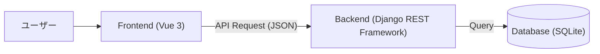
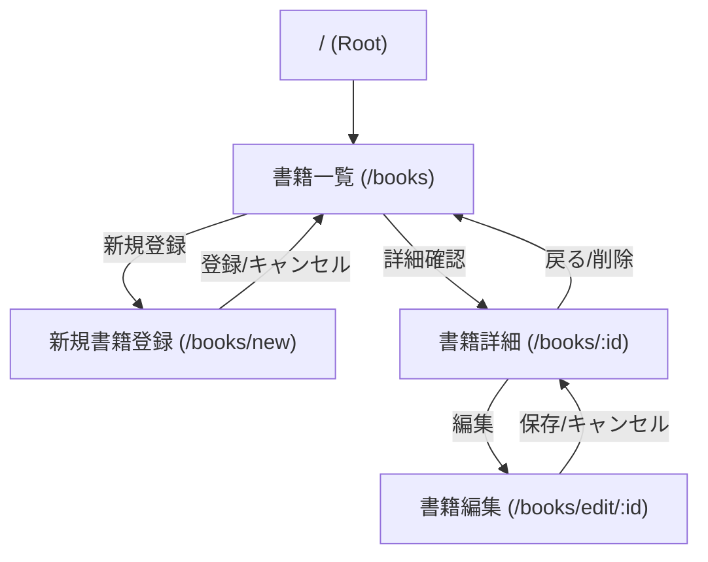
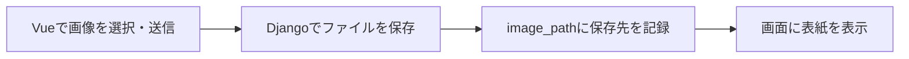

# 書籍管理システム 基本設計書

**バージョン**: v1.1.0  
**作成日**: 2026/01/27  
**更新日**: 2026/11/04

## 1. アーキテクチャ構成
画面はVue、APIとデータの保存はDjangoが担当する。通常の書籍情報はJSONで送受信する。



## 2. データベース設計

### 2.1 テーブル定義: books
書籍情報を格納するテーブル。

| カラム名 | 論理名 | データ型 | 制約 | 説明 |
| --- | --- | --- | --- | --- |
| id | ID | Integer | PK, AutoIncrement | システム内での一意な識別子 |
| title | 書籍名 | CharField | max_length=255, Not Null | |
| author | 著者名 | CharField | max_length=255, Not Null | |
| price | 価格 | Integer | Not Null | 1以上の整数。Serializerで下限1を検証 |
| publisher | 出版社 | CharField | max_length=255, Nullable | |
| image_path | 画像パス | CharField | max_length=255, Nullable | |
| like_count | いいね数 | PositiveIntegerField | Not Null, default=0 | 追加機能専用。基本機能では使わず、列だけ最初から用意 |

モデル名は `Book`、`Meta.db_table` は `books` とする。タイトル・著者名は空文字や空白のみを許可しない。出版社・画像パスは空文字またはnullを許可する。

### 2.2 追加機能用の列

`like_count = models.PositiveIntegerField(default=0)` を最初のモデル定義に含める。

| 段階 | like_countの扱い |
| --- | --- |
| 初期準備 | 列を用意し、初期SQLで全書籍を0にする |
| 基本機能 | 表示・入力・更新には使わず、0のまま保持する |
| 追加機能 | いいね数の表示・加算などに利用する |

通常の登録・編集で上書きしないよう、Serializerに `read_only_fields = ['like_count']` を設定する。

## 3. API設計 (RESTful API)

接続先は `http://localhost:8000`。以下は基本機能のAPIとする。

| メソッド | エンドポイント | 概要 | リクエストパラメータ | レスポンス |
| --- | --- | --- | --- | --- |
| GET | `/api/books/` | 書籍一覧取得 | `keyword` (optional): 書籍名検索 | 書籍オブジェクト配列 |
| POST | `/api/books/` | 書籍新規登録 | `title`, `author`, `price`, `publisher`, `image_path` | 作成された書籍オブジェクト |
| GET | `/api/books/{id}/` | 書籍詳細取得 | - | 書籍オブジェクト |
| PUT | `/api/books/{id}/` | 書籍更新 | `title`, `author`, `price` は必須。編集画面からは任意項目も含む5項目を送信 | 更新後の書籍オブジェクト |
| PATCH | `/api/books/{id}/` | 書籍の部分更新 | 変更する項目のみ | 更新後の書籍オブジェクト |
| DELETE | `/api/books/{id}/` | 書籍削除 | - | 204 No Content |

- APIのベースURLは `http://localhost:8000/api/`。各URL末尾の `/` を付ける。
- 正常時は取得・更新が200、登録が201、削除が204。入力不備は400、対象なしは404とする。
- 登録時の `publisher` と `image_path` は省略できる。`keyword` を省略または空文字にすると全件取得する。検索結果0件は空配列を返す。
- フロントエンドの編集では、参考用テキストと同じPUTを使用する。PATCHはAPI仕様として対応するが、画面実装では使わない。

### 3.1 追加機能のAPI

追加機能で実現したい動作は第7章に示す。必要なAPIのURL・パラメータ・応答形式は、受講者が考えてよい。

## 4. Frontend画面設計

### 4.1 画面一覧

| 画面 | Vueファイル | 主な役割 |
| --- | --- | --- |
| 一覧 | BookListView.vue | 全件表示・書籍名検索・詳細への移動 |
| 詳細 | BookDetailView.vue | 1冊の情報表示・編集・削除 |
| 新規登録 | NewBookView.vue | 入力内容を登録 |
| 編集 | BookEditView.vue | 登録済みの情報を変更 |

### 4.2 ディレクトリ構成案
```
frontend/src/views/
  ├── BookListView.vue
  ├── BookDetailView.vue
  ├── BookEditView.vue
  └── NewBookView.vue
```

### 4.3 画面レイアウト・構成
基本レイアウトは `App.vue` にて定義し、ヘッダー・サイドバー・フッターを共通コンポーネントとして配置する。
メインコンテンツ部分のみ `RouterView` で切り替える構成とする。

**レイアウト構成図:**


この図は領域分割の参考図であり、表示項目・データ・文言は以下の画面詳細に従う。

### 4.4 画面詳細・遷移定義

第4章は基本機能の画面例。追加機能の画面例は第7章に掲載する。

#### 4.4.1 書籍一覧画面 (BookListView)
- **機能**: 全書籍を一覧表示する。初期画面として表示される。
- **表示項目**: 画像（サムネイル）、ID、書籍名、著者名、価格、詳細ボタン。
- **アクション**:
    - 「詳細」ボタン: その書籍の詳細画面 (`/books/:id`) へ遷移。
    - 「新規登録」メニュー: 新規登録画面 (`/books/new`) へ遷移。
- **検索**: 書籍名の部分一致検索。検索結果0件は「該当する書籍がありません。」と表示する。
- **状態表示**: API取得中は「読み込み中...」、取得失敗時は画面内にエラーを表示する。
- **画像**: `public/images/1.png` のファイルを表示する場合、保存値は `/images/1.png` とする。画像パスが空文字またはnullなら「画像なし」と表示する。

**画面イメージ:**


#### 4.4.2 書籍詳細画面 (BookDetailView)
- **機能**: 特定の書籍の詳細情報を表示する。
- **表示項目**: 書籍画像（大）、ID、タイトル、著者名、価格、出版社、画像パス。画像未指定時は「画像なし」と表示する。
- **状態表示**: 取得中は読み込み表示、取得・削除失敗時は画面内エラーと一覧への戻り先を表示する。
- **アクション**:
    - 「編集」ボタン: 編集画面 (`/books/edit/:id`) へ遷移。
    - 「削除」ボタン: 削除確認ダイアログを表示し、OKなら削除実行後、一覧画面へ戻る。
    - 「戻る」等のナビゲーション: 一覧画面へ戻る。

**画面イメージ:**


#### 4.4.3 書籍登録・編集画面 (NewBookView / BookEditView)
- **機能**: 書籍の新規登録、および既存書籍情報の編集を行う。
- **入力項目**:
    - タイトル (必須)
    - 著者名 (必須)
    - 価格 (必須, 1以上の整数)。登録・編集とも `min="1"`、`step="1"` と送信前チェックを使う。
    - 出版社 (任意)
    - 画像パス (任意, 最大255文字): `/images/1.png` のように先頭に `/` を付ける。`public/` は入力しない。http/httpsの画像URLも指定できる。未指定時は画像を読み込まず「画像なし」と表示する。
    - タイトル・著者名・出版社は最大255文字。タイトル・著者名の空白のみの入力は認めない。
- **アクション**:
    - 「登録」ボタン: 入力内容を検証し、POSTで登録。成功後は一覧画面へ遷移。
    - 「保存」ボタン: 入力内容を検証し、PUTで更新。成功後はその書籍の詳細画面へ遷移。
    - 「キャンセル」ボタン: 新規登録時は一覧、編集時はその書籍の詳細画面へ戻る。
    - 編集画面の初期取得に失敗した場合はフォームを表示せず、エラーと一覧への戻り先を表示する。

**画面イメージ:**


### 4.5 画面遷移図
システム全体の画面遷移は以下の通りである。



## 5. 共通方針・その他

### 5.1 エラーハンドリング方針
- **APIエラー**: `try/catch` で受け取り、`error = ref<string | null>(null)` と `v-if` で画面内に表示する。成功時は `alert()`、削除確認には `confirm()` を使う。
- **バリデーション**: Frontendの必須・価格チェックに加え、BackendのSerializerでも空白・最大文字数・整数・価格の下限を検証する。`BookSerializer.Meta.extra_kwargs` で `price` の `min_value` を1に設定する。

### 5.2 セキュリティ方針
- **CORS**: `http://localhost:5173`、`http://localhost:5174`、`http://localhost:5175` を `CORS_ALLOWED_ORIGINS` に設定する。教材では5173を使う。
- 本教材はローカル演習用。公開運用の認証・権限制御は演習範囲外とする。

### 5.3 ディレクトリ構成 (Frontend)
```
frontend/src/
  ├── components/
  │   ├── HeaderMenu.vue
  │   ├── SideMenu.vue
  │   └── FooterInfo.vue
  ├── views/
  │   ├── BookListView.vue     # 一覧
  │   ├── BookDetailView.vue   # 詳細
  │   ├── BookEditView.vue     # 編集
  │   └── NewBookView.vue      # 新規登録
  ├── router/
  │   └── index.ts             # ルーティング定義
  └── App.vue                  # ルートコンポーネント
```

### 5.4 ディレクトリ構成・初期化 (Backend)

```
backend-django/
  ├── initial_data.sql
  ├── manage.py
  ├── books/
  │   ├── models.py
  │   ├── serializers.py
  │   ├── views.py
  │   └── migrations/
  └── config/
      ├── settings.py
      └── urls.py
```

| 順序 | 作業 |
| --- | --- |
| 1. 作成・設定 | READMEの手順でプロジェクトとアプリを作成し、アプリ・CORS・APIのURLを設定 |
| 2. モデル・DB | モデルを作成し、`makemigrations` → `migrate` を実行 |
| 3. 初期データ | 空の書籍テーブルへ `initial_data.sql` を投入し、10件を確認 |
| 4. 起動 | Djangoは `runserver`（8000）、Vueは `npm install` → `npm run dev`（5173） |

## 6. 動作環境 (推奨)

### 6.1 クライアント
- **ブラウザ**: Google Chrome (最新版), Microsoft Edge (最新版), Firefox (最新版), Safari (最新版)
- **OS**: Windows 10/11, macOS, Linux

### 6.2 サーバー (開発環境)
- **Python**: 3.10以上（演習環境は3.13）
- **Backend**: Django 5.2系、Django REST Framework 3.16.1、django-cors-headers 4.9.0をインストール済みであること。
- **Node.js**: 22.12以上の22系、または24系を推奨。Vite 7の最低要件は20.19以上の20系、または22.12以上。
- **DBMS**: SQLite3 (開発・検証用)。初期データの投入にはSQLite3コマンドラインツールを使用する。
- **画像添付を実装する場合**: 画像検証用にPillow（11.1以上、13未満）を追加する。機能の考え方は第7章を参照する。

## 7. 追加機能

### 7.1 取り組み方

基本機能を完成させた後、好きな機能を選んで取り組む任意課題。3つすべての実装は必須ではない。

| 機能 | できるようにすること |
| --- | --- |
| 並び替え | 一覧の表示順をボタンで変更する |
| いいね | 書籍ごとのいいね数を増やし、保存する |
| 画像ファイル添付 | PCの画像を選んで書籍の表紙にする |

業務用テーブルは `books` の1つ。いいねには準備済みの `like_count`、画像には既存の `image_path` を使う。

**画面例・解答コードは一例。** ボタンの種類や配置、APIの作り方、画像形式・容量などの細部は受講者に任せる。

### 7.2 追加機能1：並び替えボタン

一覧に複数の並び替えボタンを追加し、表示順を変更できるようにする。検索中は、検索結果を対象に並び替える。

| 並び順の例 | 画面での変化 |
| --- | --- |
| 価格が安い順・高い順 | 価格を基準に順番が変わる |
| 書籍名順・ID順 | 名前や登録順で探しやすくなる |
| いいねが多い順 | 人気のある書籍から表示する |

下図の全ボタンを揃える必要はない。どの並び順を用意するか、VueとDjangoのどちらで並び替えるかも考えてよい。


### 7.3 追加機能2：いいね

| 最低限の動作 | 内容 |
| --- | --- |
| 押す | 一覧または詳細にボタンを置き、1回押すと1増える |
| 保存する | `like_count` に保存し、再読み込み後も回数が残る |
| 続けて押す | ユーザー管理は行わず、同じ人が何度押してもよい |


通常の書籍編集で回数を変えない。ボタンの配置や表示の更新方法は自由に工夫する。


### 7.4 追加機能3：画像ファイル添付

登録・編集画面で画像ファイルを選べるようにし、保存後の一覧・詳細に表紙として表示する。



| 担当 | 考えること |
| --- | --- |
| Vue | ファイルの選択欄を追加し、Djangoへ送る |
| Django | 画像を保存し、Vueから表示できるURLを返す |
| DB | ファイル本体ではなく、既存の `image_path` にURLを保存する |

画像を扱うにはVueとDjangoの両方に処理を追加する。ファイル入力・FormData・MEDIA設定などを調べながら進める。画像形式や容量、プレビューの有無は自分で決めてよい。


