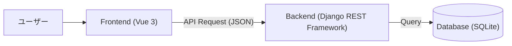
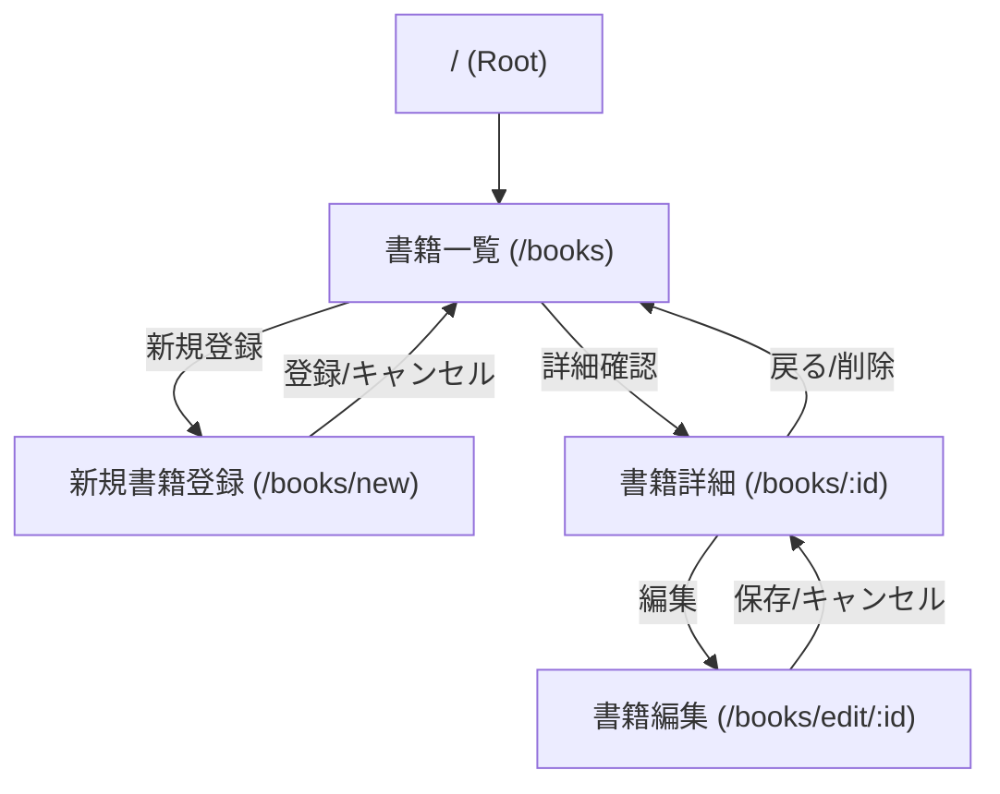

# 書籍管理システム 基本設計書

**バージョン**: v1.1.0  
**作成日**: 2026/01/27  
**更新日**: 2026/11/02

## 1. アーキテクチャ構成
本システムは、FrontendとBackendを分離したSPA（Single Page Application）構成とする。



## 2. データベース設計

### 2.1 テーブル定義: books
書籍情報を格納するテーブル。

| カラム名 | 論理名 | データ型 | 制約 | 説明 |
| --- | --- | --- | --- | --- |
| id | ID | Integer | PK, AutoIncrement | システム内での一意な識別子 |
| title | 書籍名 | CharField | max_length=255, Not Null | |
| author | 著者名 | CharField | max_length=255, Not Null | |
| price | 価格 | Integer | Not Null | 1以上の整数。Serializerで下限1を検証 |
| publisher | 出版社 | CharField | max_length=255, Nullable | |
| image_path | 画像パス | CharField | max_length=255, Nullable | |

モデル名は `Book`、`Meta.db_table` は `books` とする。タイトル・著者名は空文字や空白のみを許可しない。出版社・画像パスは空文字またはnullを許可する。

## 3. API設計 (RESTful API)

| メソッド | エンドポイント | 概要 | リクエストパラメータ | レスポンス |
| --- | --- | --- | --- | --- |
| GET | `http://localhost:8000/api/books/` | 書籍一覧取得 | `keyword` (optional): 書籍名検索 | 書籍オブジェクト配列 |
| POST | `http://localhost:8000/api/books/` | 書籍新規登録 | `title`, `author`, `price`, `publisher`, `image_path` | 作成された書籍オブジェクト |
| GET | `http://localhost:8000/api/books/{id}/` | 書籍詳細取得 | - | 書籍オブジェクト |
| PUT | `http://localhost:8000/api/books/{id}/` | 書籍更新 | `title`, `author`, `price` は必須。編集画面からは任意項目も含む5項目を送信 | 更新後の書籍オブジェクト |
| PATCH | `http://localhost:8000/api/books/{id}/` | 書籍の部分更新 | 変更する項目のみ | 更新後の書籍オブジェクト |
| DELETE | `http://localhost:8000/api/books/{id}/` | 書籍削除 | - | 204 No Content |

- APIのベースURLは `http://localhost:8000/api/`。各URL末尾の `/` を付ける。
- 正常時は取得・更新が200、登録が201、削除が204。入力不備は400、対象なしは404とする。
- 登録時の `publisher` と `image_path` は省略できる。`keyword` を省略または空文字にすると全件取得する。検索結果0件は空配列を返す。
- フロントエンドの編集では、参考用テキストと同じPUTを使用する。PATCHはAPI仕様として対応するが、画面実装では使わない。

## 4. Frontend画面設計

### 4.1 画面一覧
1. **書籍一覧画面 (BookListView)**
   - 全書籍をリスト形式（またはカード形式）で表示。
   - 検索バーを上部に配置。
   - 「新規登録」ボタンを配置。

2. **書籍詳細画面 (BookDetailView)**
   - 選択した書籍の詳細情報を表示。
   - 一覧へ戻る・編集・削除ボタンを配置。

3. **書籍登録・編集画面 (BookEditView / NewBookView)**
   - 書籍情報の入力フォーム。
   - 必須項目のバリデーションを行う。

### 4.2 ディレクトリ構成案
```
frontend/src/views/
  ├── BookListView.vue
  ├── BookDetailView.vue
  ├── BookEditView.vue
  └── NewBookView.vue
```

### 4.3 画面レイアウト・構成
基本レイアウトは `App.vue` にて定義し、ヘッダー・サイドバー・フッターを共通コンポーネントとして配置する。
メインコンテンツ部分のみ `RouterView` で切り替える構成とする。

**レイアウト構成図:**


この図は領域分割の参考図であり、表示項目・データ・文言は以下の画面詳細に従う。

### 4.4 画面詳細・遷移定義

#### 4.4.1 書籍一覧画面 (BookListView)
- **機能**: 全書籍を一覧表示する。初期画面として表示される。
- **表示項目**: 画像（サムネイル）、ID、書籍名、著者名、価格、詳細ボタン。
- **アクション**:
    - 「詳細」ボタン: その書籍の詳細画面 (`/books/:id`) へ遷移。
    - 「新規登録」メニュー: 新規登録画面 (`/books/new`) へ遷移。
- **検索**: 書籍名の部分一致検索。検索結果0件は「該当する書籍がありません。」と表示する。
- **状態表示**: API取得中は「読み込み中...」、取得失敗時は画面内にエラーを表示する。
- **画像**: `public/images/1.png` のファイルを表示する場合、保存値は `/images/1.png` とする。画像パスが空文字またはnullなら「画像なし」と表示する。

**画面イメージ:**


#### 4.4.2 書籍詳細画面 (BookDetailView)
- **機能**: 特定の書籍の詳細情報を表示する。
- **表示項目**: 書籍画像（大）、ID、タイトル、著者名、価格、出版社、画像パス。画像未指定時は「画像なし」と表示する。
- **状態表示**: 取得中は読み込み表示、取得・削除失敗時は画面内エラーと一覧への戻り先を表示する。
- **アクション**:
    - 「編集」ボタン: 編集画面 (`/books/edit/:id`) へ遷移。
    - 「削除」ボタン: 削除確認ダイアログを表示し、OKなら削除実行後、一覧画面へ戻る。
    - 「戻る」等のナビゲーション: 一覧画面へ戻る。

**画面イメージ:**


#### 4.4.3 書籍登録・編集画面 (NewBookView / BookEditView)
- **機能**: 書籍の新規登録、および既存書籍情報の編集を行う。
- **入力項目**:
    - タイトル (必須)
    - 著者名 (必須)
    - 価格 (必須, 1以上の整数)。登録・編集とも `min="1"`、`step="1"` と送信前チェックを使う。
    - 出版社 (任意)
    - 画像パス (任意, 最大255文字): `/images/1.png` のように先頭に `/` を付ける。`public/` は入力しない。http/httpsの画像URLも指定できる。未指定時は画像を読み込まず「画像なし」と表示する。
    - タイトル・著者名・出版社は最大255文字。タイトル・著者名の空白のみの入力は認めない。
- **アクション**:
    - 「登録」ボタン: 入力内容を検証し、POSTで登録。成功後は一覧画面へ遷移。
    - 「保存」ボタン: 入力内容を検証し、PUTで更新。成功後はその書籍の詳細画面へ遷移。
    - 「キャンセル」ボタン: 新規登録時は一覧、編集時はその書籍の詳細画面へ戻る。
    - 編集画面の初期取得に失敗した場合はフォームを表示せず、エラーと一覧への戻り先を表示する。

**画面イメージ:**


### 4.5 画面遷移図
システム全体の画面遷移は以下の通りである。



## 5. 共通方針・その他

### 5.1 エラーハンドリング方針
- **APIエラー**: `try/catch` で受け取り、`error = ref<string | null>(null)` と `v-if` で画面内に表示する。成功時は `alert()`、削除確認には `confirm()` を使う。
- **バリデーション**: Frontendの必須・価格チェックに加え、BackendのSerializerでも空白・最大文字数・整数・価格の下限を検証する。`BookSerializer.Meta.extra_kwargs` で `price` の `min_value` を1に設定する。

### 5.2 セキュリティ方針
- **CORS**: `http://localhost:5173`、`http://localhost:5174`、`http://localhost:5175` を `CORS_ALLOWED_ORIGINS` に設定する。教材では5173を使う。
- 本教材はローカル演習用。公開運用の認証・権限制御は演習範囲外とする。

### 5.3 ディレクトリ構成 (Frontend)
```
frontend/src/
  ├── components/
  │   ├── HeaderMenu.vue
  │   ├── SideMenu.vue
  │   └── FooterInfo.vue
  ├── views/
  │   ├── BookListView.vue     # 一覧
  │   ├── BookDetailView.vue   # 詳細
  │   ├── BookEditView.vue     # 編集
  │   └── NewBookView.vue      # 新規登録
  ├── router/
  │   └── index.ts             # ルーティング定義
  └── App.vue                  # ルートコンポーネント
```

### 5.4 学習済みコードとの対応

- Vueは参考用 `ch05-crud` と同じ `<script setup lang="ts">`、`ref`、`onMounted`、Axios、Vue Router、Bootstrapを用いる。
- 入力項目ごとに `ref` を定義し、送信オブジェクトを作成してPOST・PUTする。独自のAPI共通クラスや状態管理ライブラリは導入しない。
- 参考用のExpressは総合演習ではDjango REST Frameworkに置き換える。Modelはテーブル定義、SerializerはJSON変換と入力検証、ViewSetはCRUD、RouterはAPIのURL登録を担当する。
- スターターではこれらのバックエンド機能と画面処理を受講者が実装する。具体的な作業順序はスターターREADMEに従う。

## 6. 動作環境 (推奨)

### 6.1 クライアント
- **ブラウザ**: Google Chrome (最新版), Microsoft Edge (最新版), Firefox (最新版), Safari (最新版)
- **OS**: Windows 10/11, macOS, Linux

### 6.2 サーバー (開発環境)
- **Python**: 3.13
- **Backend**: Django 5.2系、Django REST Framework 3.16.1、django-cors-headers 4.9.0。`requirements.txt` を使用する。
- **Node.js**: 22.12以上の22系、または24系を推奨。Vite 7の最低要件は20.19以上の20系、または22.12以上。
- **DBMS**: SQLite3 (開発・検証用)
